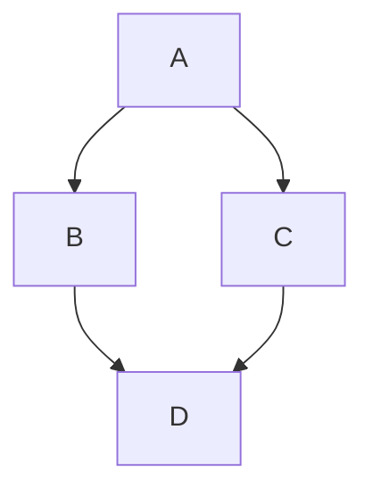

# Abstract

...


# Introduction

Research software is central to modern life sciences, yet identifying trustworthy, maintainable, and reusable tools remains difficult. Researchers often rely on names, brief descriptions, topics, and community reputation when selecting software, while signals of documentation quality, maintenance activity, FAIR alignment, and reuse are scattered across repositories, metadata services, and publication databases.

The Maturity Meter project develops an automated maturity model for research software tools hosted on GitHub or GitLab. Its goal is to provide a scalable and informative complement to manual maturity assessment by combining heterogeneous metadata and repository signals into maturity indicators.

In the longer term, the model is intended to support software disambiguation and discovery in the bio.tools registry: helping researchers distinguish tools with similar names or functionality and make more informed choices based on evidence of quality, maintenance, and reuse.

# Approach

Maturity Meter evaluates a research software repository using signals drawn from multiple sources:

| Source | Examples of signals | Role in assessment |
|---|---|---|
| bio.tools | Tool description, topics, functions, availability, documentation links | Contextual and community-curated metadata |
| OpenEBench | Tool-related quality and benchmarking metadata | Additional research-software metadata |
| GitHub or GitLab | Repository activity, issues, releases, documentation, licensing, community signals | Maintenance and development indicators |
| Europe PMC | Publications and citations associated with a tool | Usage, reuse, and scholarly impact signals |
| Static analysis | Code-quality and repository-structure indicators | Automated technical-quality signals |


# Results

During the BioHackathon, 

...


## Implementation

Maturity Meter is implemented as a command-line tool, Python library, and web API.

...


## 

An example evaluation of `<repository URL>` produced the following result:

| Component | Result | Interpretation |
|---|---:|---|
| Compatibility | <value or placeholder> | <Brief interpretation> |
| FAIRness | <value or placeholder> | <Brief interpretation> |
| Maintainability | <value or placeholder> | <Brief interpretation> |
| Scientific Impact | <value or placeholder> | <Brief interpretation> |
| Overall maturity | <value or placeholder> | <Brief interpretation> |


    
# Discussion

Automated maturity assessment cannot replace expert judgement, but it can make repeated, large-scale assessment more consistent and timely. By combining curated metadata, repository signals, publication information, and static analysis, Maturity Meter aims to provide a useful first-pass indicator of research software maturity.

The approach also has limitations. Metadata may be incomplete or inconsistent across sources; repository activity does not necessarily measure scientific quality; and...
    

# Conclusion and future work


- Validate maturity scores against curated expert assessments.
- Improve handling of incomplete, inconsistent, or ambiguous metadata.
- Develop user facing reports and visualisations for individual tools and collections.
- Explore integration with software discovery and disambiguation services like bio.tools.
- Support community review and periodic re-evaluation of maturity scores.


# GitHub repository and data repositories

* GitHub repository: https://github.com/bio-tools/maturity-meter
* 


# Report tutorial 


### Contributor Role Taxonomy

A last feature since is minimal support for the Contributor Role Taxonomy (CRediT). You
can specify the role of authors in writing the report with the `role:` field. However,
the authors are responsible for selection the right terms from [CRediT](https://credit.niso.org/).
An example looks like this:

```yaml
authors:
  - name: First Author
    affiliation: 1
    orcid: 0000-0000-0000-0000
    role: Conceptualization, Writing – review & editing
```


## Subsection level 2

## Figures

```markdown

```

This gives:


Figures can be scaled by adding the width or height to the Markdown like this:

```markdown
{ width=50px }
```

You can add cross references to figures by adding a LaTeX `\label{figureCode}` to
the label of the Markdown figure and then use `\ref{figureCode}` to cite it:

```markdown
{ width=50px }
```

This way, we can cite Figure \ref{figureCode}.

## Mermaid graphs

[Mermaid](https://mermaid.js.org/) provides a solution to put diagrams in Markdown. BioHackrXiv
added support for this in 2026. This is an example of embedding a graph:




# Citation Typing Ontology annotation

You can use [CiTO](http://purl.org/spar/cito/2018-02-12) annotations, as explained in [this BioHackathon Europe 2021 write up](https://raw.githubusercontent.com/biohackrxiv/bhxiv-metadata/main/doc/elixir_biohackathon2021/paper.md) and [this CiTO Pilot](https://www.biomedcentral.com/collections/cito).
Using this template, you can cite an article and indicate _why_ you cite that article, for instance DisGeNET-RDF [@citesAsAuthority:Queralt2016].

The syntax in Markdown is as follows: a single intention annotation looks like
`[@usesMethodIn:Krewinkel2017]`; two or more intentions are separated
with colons, like `[@extends:discusses:Nielsen2017Scholia]`. When you cite two
different articles, you use this syntax: `[@citesAsDataSource:Ammar2022ETL; @citesAsDataSource:Arend2022BioHackEU22]`.

Possible CiTO typing annotation include:

* citesAsDataSource: when you point the reader to a source of data which may explain a claim
* usesDataFrom: when you reuse somehow (and elaborate on) the data in the cited entity
* usesMethodIn
* citesAsAuthority
* citesAsEvidence
* citesAsPotentialSolution
* citesAsRecommendedReading
* citesAsRelated
* citesAsSourceDocument
* citesForInformation
* confirms
* documents
* providesDataFor
* obtainsSupportFrom
* discusses
* extends
* agreesWith
* disagreesWith
* updates

There is a general `cites` intention, but this is already implied and should be left out.


## Acknowledgements

The authors acknowledge the ELIXIR and all organisers and participants of ELIXIR BioHackathon Europe 2026 in Barcelona, Spain ...


# References

```{=latex}
\AtEndDocument{%
```

# Appendices

If you want the Appendix (-ces) to show up after the references, wrap them in 
after the header, like done in this Markdown file. Look at the [source](paper.md)
to see the exact structure.

```{=latex}
}
```
