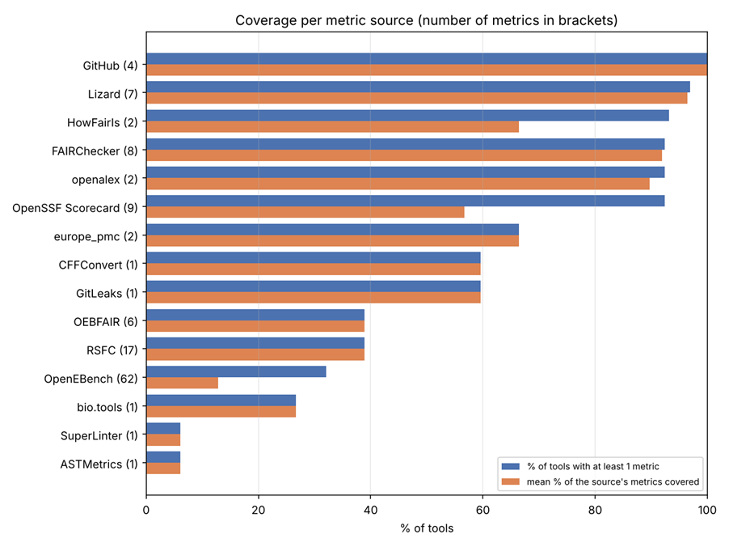
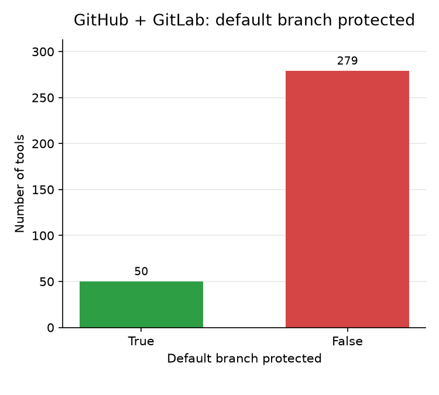
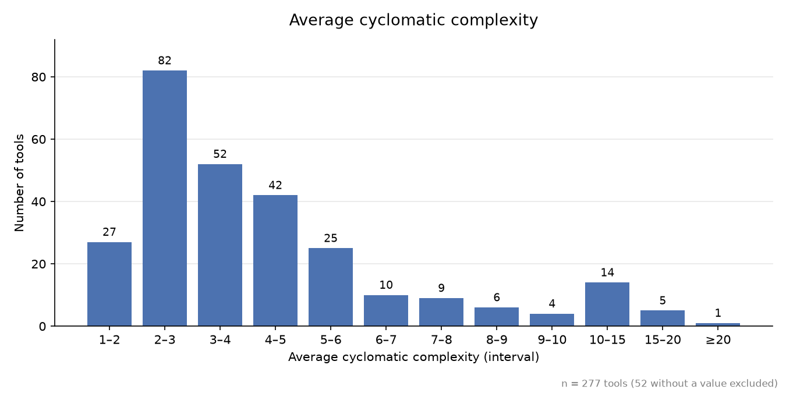

# Abstract

Research software is central to life sciences, but assessing its maturity consistently and at scale remains challenging. During BioHackathon Europe 2026, Project 20 developed *maturity meter*, a prototype automated maturity-assessment system for research software. The approach combines curated bio.tools metadata with repository signals from GitHub or GitLab, publication and citation information from Europe PMC and OpenAlex, quality and benchmarking metadata from OpenEBench, FAIR-related checks, and static repository analysis. We applied the pipeline to 834 proteomics tools in bio.tools that had an associated GitHub or GitLab repository. The implementation evaluates XXX metrics... 

...


# Introduction

Research software is central to modern life sciences, yet identifying trustworthy, maintainable, and reusable tools remains difficult. Researchers often rely on names, brief descriptions, topics, and community reputation when selecting software, while signals of documentation quality, maintenance activity, FAIR alignment, and reuse are scattered across repositories, metadata services, and publication databases.

The *maturity meter* project develops an automated maturity model for research software tools hosted on GitHub or GitLab. Its goal is to provide a scalable and informative complement to manual maturity assessment by combining heterogeneous metadata and repository signals into maturity indicators.

In the longer term, the model is intended to support software disambiguation and discovery in the bio.tools registry: helping researchers distinguish tools with similar names or functionality and make more informed choices based on evidence of quality, maintenance, and reuse.

This work extends takes the Multi-Modal Maturity Model (MMMM) as a starting point and expands it to use more sources and indicators.


# Approach

*maturity meter* evaluates a research software repository using signals drawn from multiple sources:

| Source | Examples of signals | Role in assessment |
|---|---|---|
| bio.tools | Tool description, topics, functions, availability, documentation links | Contextual and community-curated metadata |
| OpenEBench | Tool-related quality and benchmarking metadata | Additional research-software metadata |
| GitHub or GitLab | Repository activity, issues, releases, documentation, licensing, community signals | Maintenance and development indicators |
| Europe PMC | Publications and citations associated with a tool | Usage, reuse, and scholarly impact signals |
| Static analysis | Code-quality and repository-structure indicators | Automated technical-quality signals |
| FAIR-Checker and HowFAIRis | FAIR-principle and repository-policy indicators | FAIR alignment and repository hygiene |

The assessment pipeline proceeds from a source-code repository, retrieves available metadata and repository signals, calculates indicators, and produces a structured assessment result. Where an indicator can be obtained from more than one source—for example, licence information—the pipeline compares the available values and merges them into a single reported result. This reduces reliance on any individual metadata source while making disagreements between sources visible for further investigation.

During the BioHackathon Europe 2026, we selected proteomics tools from bio.tools that had an associated GitHub or GitLab repository. This domain-focused cohort provided a practical initial test set for running the pipeline at scale and examining metric coverage across a relatively coherent group of research software.


## Metrics and maturity dimensions

The implementation currently evaluates **TODO XXX metrics**. These metrics are organised around the same dimensions as in the MMMM library, including compatibility, FAIRness, maintainability, scientific impact, security, and sustainability. <!-- TODO: Confirm final dimension names and add appendix listing all metrics. -->

Several metrics are intentionally repeated across sources. For example, an indicator such as `has_license` may be derived from repository metadata, FAIR-related checks, or... The pipeline compares these observations and merges them into a single indicator value, while retaining sufficient information to identify the contributing sources.

<!-- TODO: Insert final metric configuration, including metrics retained from Resqui, FAIR-Checker, OpenEBench, Europe PMC, GitHub/GitLab, and static analysis. Include current metric weights or state explicitly that weights are under development. -->


# Results

We assessed **834 proteomics tools** listed in bio.tools that had an associated GitHub or GitLab repository. The assessment produced structured results for each tool, including individual metric values, source information where applicable, and derived maturity indicators.

<!-- TODO: Add final counts for:
- Tools with a usable repository link
- Successful assessments
- Incomplete assessments
- Failed assessments
- Metrics with complete, partial, and missing coverage
-->


## Metric coverage

Initial analysis focused on the coverage of individual metrics and indicators across the assessed cohort. Coverage varied substantially between metrics, reflecting differences in the availability and consistency of bio.tools metadata, repository metadata, publication links, and external service information.

<!-- TODO: Insert figure showing metric/indicator coverage across the 834 assessed tools. -->

{ width=70% }

<!-- TODO: selected metrics? -->


## Initial indicator results

We generated exploratory visualisations for selected metrics, including indicators related to repository management and code complexity. For example, bar plots were produced for protected-branch usage and complexity-related metrics.

<!-- TODO: Insert selected bar plots, for example protected branches and code complexity. Keep the interpretation concise until final results are available. -->

{ width=50% }

{ width=50% }

These initial results are intended to identify broad patterns and data-quality issues rather than to draw definitive conclusions about individual tools. In particular, differences in repository hosting practices, repository activity, and metadata availability may affect the interpretation of individual indicators.


## Maturity profiles

<!-- TODO: Insert radar/spider plot comparing a small number of representative proteomics tools across MMMM dimensions. -->

{ width=70% }

<!-- TODO: Add example table with real repository URL and scores once available. -->

| Component | Result | Interpretation |
|---|---:|---|
| Compatibility | _placeholder_ | _Brief interpretation_ |
| FAIRness | _placeholder_ | _Brief interpretation_ |
| Maintainability | _placeholder_ | _Brief interpretation_ |
| Scientific impact | _placeholder_ | _Brief interpretation_ |
| Security | _placeholder_ | _Brief interpretation_ |
| Sustainability | _placeholder_ | _Brief interpretation_ |
| Overall maturity | _placeholder_ | _Brief interpretation_ |


## Weighting and aggregation

...

<!-- TODO: Describe the weighting schemes tested, their effect on rankings or scores, and any preliminary observations. -->


# Implementation

*maturity meter* is implemented as a command-line tool, Python library, and web API. A single repository can be evaluated directly, while batch evaluation supports assessment of multiple tools from a CSV input. Results can be saved as JSON, and previously fetched data can be reused to avoid unnecessary repeated retrieval.

```bash
poetry run maturity-meter evaluate [https://github.com/owner/repo](https://github.com/owner/repo)
```

...


## Resqui integration

...


## Service and visualization


    
# Discussion

Automated maturity assessment cannot replace expert judgement, but it can make repeated, large-scale assessment more consistent and timely. By combining curated metadata, repository signals, publication information, static analysis, and FAIR-related checks, *maturity meter* aims to provide a useful first-pass indicator of research software maturity.

...


# Conclusion and future work

*maturity meter* provides a working foundation for automated, reproducible maturity assessment of research software in bio.tools. The BioHackathon project produced a scalable assessment workflow, improved Resqui integrations, an API prototype, and initial coverage and indicator visualisations.

Future work will focus on:

- Validating maturity scores against curated expert assessments.
- Improving handling of incomplete, inconsistent, or ambiguous metadata.
- Developing user facing reports with suggestions and visualisations for individual tools and collections.
- Exploring integration with software discovery services like bio.tools.
- Supporting community review and periodic re-evaluation of maturity scores.


# GitHub repository and data repositories

* *maturity meter* implementation: https://github.com/bio-tools/maturity-meter
* Official project description: https://github.com/elixir-europe/biohackathon-projects-2026/blob/main/20.md


## Acknowledgements

The authors acknowledge ELIXIR and all organisers and participants of ELIXIR BioHackathon Europe 2026 in Barcelona, Spain ... TDCC-LSH ...


# References

```{=latex}
\AtEndDocument{%
```

# Appendices

If you want the Appendix (-ces) to show up after the references, wrap them in 
after the header, like done in this Markdown file. Look at the [source](paper.md)
to see the exact structure.

```{=latex}
}
```
